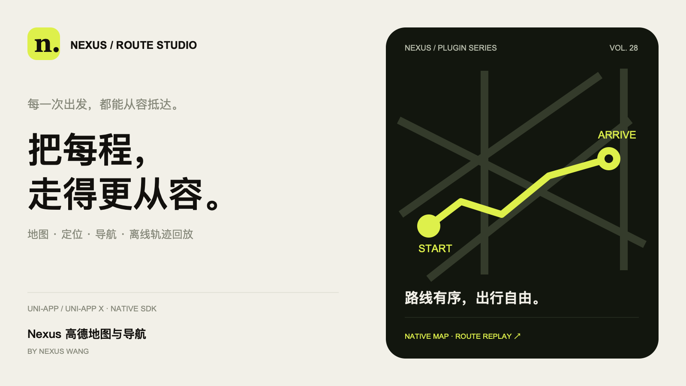
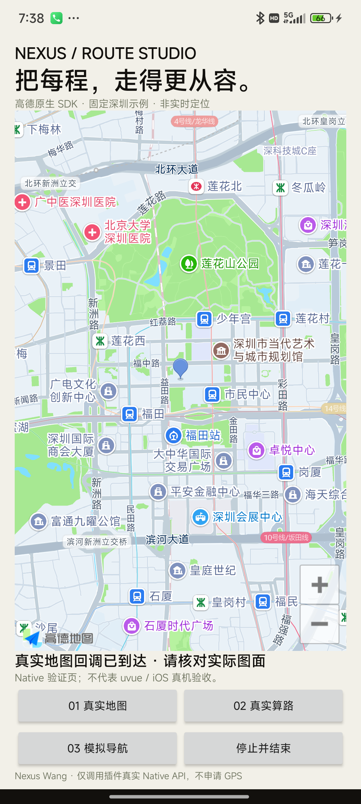
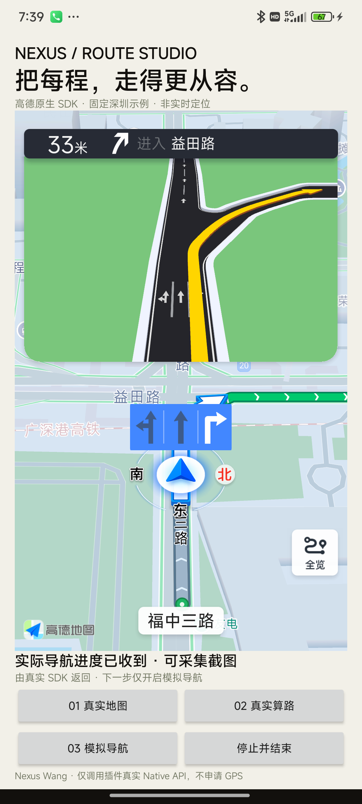

# Nexus 高德地图与导航

**Nexus Wang · uni-app / uni-app x · 1.0.0**

把每程，走得更从容。真实高德地图、前台定位、搜索与多方式导航，新增本地离线轨迹记录与回放。

[插件市场 · 试用与购买](https://ext.dcloud.net.cn/plugin?id=30659) · **1.0.0 已上架**。

普通授权目标价 **¥79.90**（市场当前 **¥79.91**，差 1 分，平台改价限制解除后更正）· 源码授权版 **¥2499.00**。高德商业服务许可、Key、调用配额和货车权限由使用方独立配置，不包含在插件售价中。

[完整 API 与接入文档](docs/api-and-setup.md) · [Android Key 配置](examples/android/README.md) · [测试范围](docs/verification.md) · [全部 Nexus 插件画廊](https://awak3n1ngone.github.io/nexus-uniapp-plugins/)

## 真实地图与模拟导航

以下截图来自 Android 14 上独立的 Native QA 宿主，使用固定深圳示例坐标，不获取手机 GPS；不是 uvue/nvue 真机页面验收。

| 真实高德地图 | 实际 SDK 模拟导航 |
| --- | --- |
|  |  |

## 功能与平台

- 原生嵌入地图、中心缩放、标记、折线、覆盖物管理。
- 显式授权后的前台定位、POI 搜索、地址及逆地址解析。
- 驾车、货车、步行、骑行路线与导航接口；模拟导航与实时 GPS 分开触发，货车需额外服务权限。
- 本地离线轨迹记录、暂停续记、分段回放、JSON 导出及删除；不自动定位或上传。
- 简单距离/面积测量，明确坐标系与近似方法。

Android API23+ / ARM32、ARM64；iOS13.4+ / arm64。支持 uni-app x uvue VDOM 与 uni-app App nvue；不支持普通 App vue、Web、小程序、HarmonyOS、蒸汽模式。固定 SDK 版本和高德单例共存限制详见接入文档。

## 验证范围

本轮真实 Android Native 测试通过：地图可见、3条服务器驾车路线、SDK 实际开始模拟导航、21次变化进度与真实停止事件。8个调用均成功、主线程、各一次回调，无 GPS 请求。

HBuilderX5.34 Android uvue 与 Vue2/Vue3 nvue 编译通过；iOS真实 SDK、UTS/组件生成代码和 DCloud Runtime 的 arm64 类型检查及链接通过。离线 Kotlin36/36、Swift38/38，双插件存储隔离通过。

尚未验收 UTS/uvue/nvue 真机流程、iOS 真机及签名包、GPS/连续定位、在线搜索/地址解析、货车商业服务、步行/骑行真机导航、物理可听语音；iOS HBuilder CocoaPods 自动原生构建也未验证。[完整验证说明](docs/verification.md)。

## 公开内容

本仓库仅含说明、配置指导、品牌封面和审核后的真实截图。收费的 Kotlin / Swift / UTS 实现、第三方 SDK 二进制、APK、签名及真实 Key 不公开。

作者：**Nexus Wang**。
